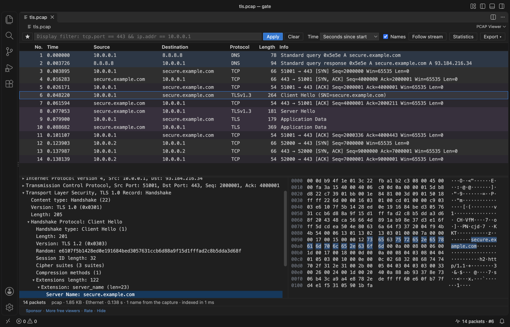
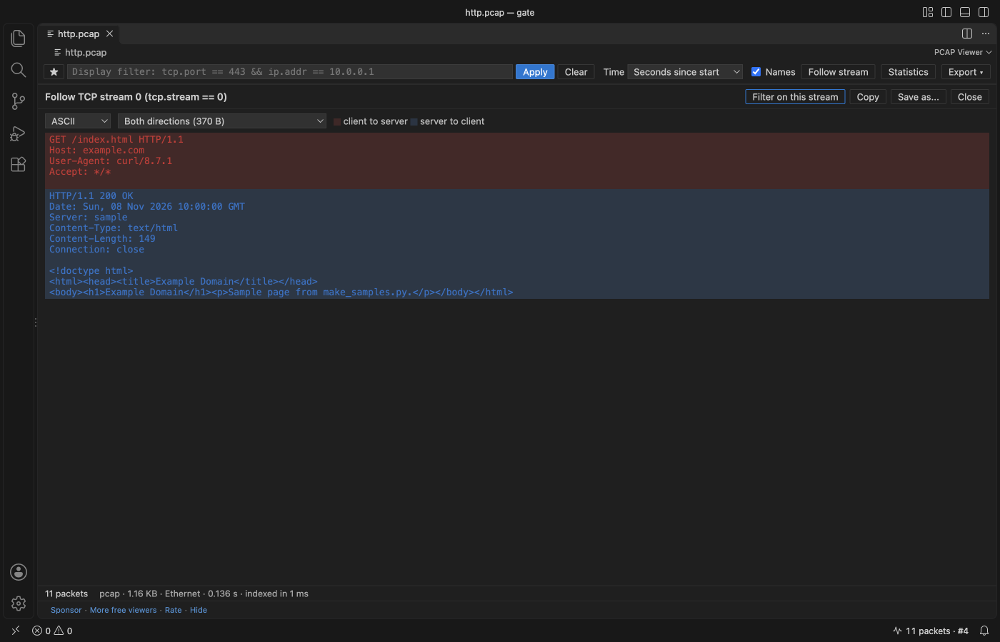
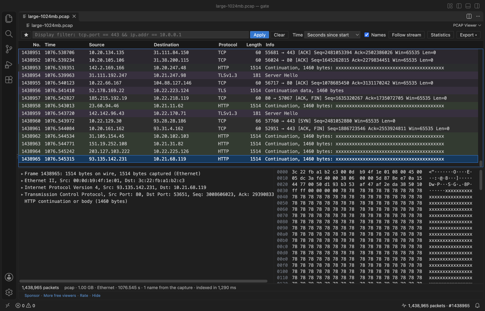
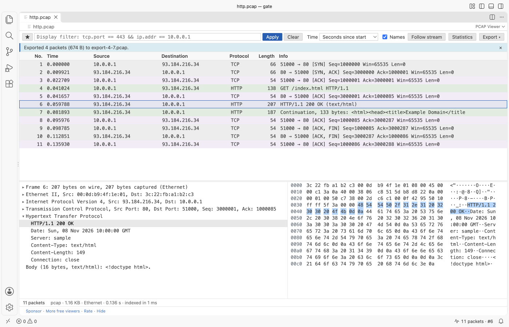

# PCAP Viewer & PCAPNG Viewer (Packet Capture Analyzer)

Free, no sign-in, works offline. Open `.pcap`, `.pcapng`, `.pcap.gz` and `.pcapng.gz` captures in VS Code and read them like in a packet analyzer: a packet list, a protocol tree, a hex pane linked to the tree, display filters, follow TCP stream, conversations and endpoints. Everything runs in JavaScript inside VS Code. You do not need Wireshark, tshark or sharkd.

![http.pcap open in PCAP Viewer inside VS Code. The packet list shows a TCP handshake, an HTTP GET for /index.html, the 200 OK response and the FIN packets, each row tinted by protocol. Packet 4 is selected. The protocol tree below lists Frame, Ethernet II, IPv4, TCP and Hypertext Transfer Protocol; the Host: example.com line is selected and its 19 bytes are lit in the hex pane on the right. The toolbar has the display filter with a star menu, Apply, Clear, the time format, Names, Follow stream, Statistics and Export.](https://github.com/theluckystrike/pcap-viewer-vscode/raw/HEAD/images/pcap-viewer-http.png)

*Real output from VS Code 1.142 on macOS. `scripts/e2e-vscode.mjs` installed the packaged extension in a clean VS Code profile, opened `http.pcap` (made by `scripts/make_samples.py`), clicked packet 4 and the Host line, and saved the window through the debug port.*

- Nothing to install, on Windows, macOS and Linux. Other viewers need a local Wireshark with `sharkd`; when the path is wrong they stop at "sharkd connection not ready". This one reads the file itself.
- `.pcap.gz` and `.pcapng.gz` open directly, unpacked in memory with a size cap, so a gzip bomb stops with a message.
- Host names come from the capture itself: DNS answers in its packets and the name blocks of pcapng files. Nothing is looked up on the network, so opening a capture never sends a DNS query.
- Click a field to light up its bytes. Click a byte to find its field.

## Quick start

1. Install PCAP Viewer.
2. Click a `.pcap`, `.pcapng`, `.pcap.gz` or `.pcapng.gz` file. For `.cap` or other names, right-click the file in the Explorer and pick "Open in PCAP Viewer".
3. Type a filter such as `tcp.port == 443 && ip.addr == 10.0.0.1` and press Enter. Double-click a packet to follow its stream.

"PCAP Viewer: Get Started" in the Command Palette opens a short tour.

## What it reads

| | |
|---|---|
| Files | pcap (microsecond and nanosecond, little and big-endian), pcapng (section, interface, enhanced and simple packet blocks, name resolution blocks, comments; other blocks are skipped), both as `.gz` |
| Link types | Ethernet, 802.1Q VLAN, Linux cooked capture (SLL and SLL2), raw IPv4 and IPv6, BSD loopback, 802.11 (header) and radiotap |
| Protocols | ARP, IPv4, IPv6 with extension headers, ICMP, ICMPv6, TCP (with options), UDP, DNS and mDNS, DHCP, HTTP/1.x, TLS records with the Client Hello server name (SNI) and ALPN, QUIC long headers |

## Display filters

The filter box takes the common part of the Wireshark display filter syntax. It turns green when the filter is valid and says what is wrong when it is not.

| Filter | Shows |
|---|---|
| `tcp`, `udp`, `dns`, `http`, `tls`, `quic`, `arp`, `icmp`, `dhcp` | packets with that protocol |
| `ip.addr == 10.0.0.1`, `ip.src`, `ip.dst`, `ipv6.addr` | an address, either side or one side |
| `ip.addr == 10.0.0.0/24` | a subnet |
| `tcp.port == 443`, `udp.port in {53 5353}` | a port or a set of ports |
| `dns.qry.name contains "example"`, `http.host matches "^api\."` | text in a field |
| `tls.sni == "example.com"`, `http.request.method == "POST"` | one server name, one method |
| `frame.len > 1000`, `tcp.flags.syn == 1`, `tcp.stream == 3` | sizes, flags, one connection |

Join conditions with `&&`, `||` and `!` (or `and`, `or`, `not`) and brackets. The star button saves filters you use often (setting `pcapViewer.savedFilters`).

## Follow stream, statistics and export

- Follow stream (double-click a packet): the data of one TCP or UDP connection in order, client to server in red and server to client in blue, as ASCII, UTF-8 or a hex dump. Copy it or save it to a file. Retransmitted bytes are shown once.
- Statistics: protocol hierarchy, conversations (Ethernet, IPv4, IPv6, TCP, UDP), endpoints and the names found in the capture. Click a row to filter on it.
- Right-click a packet to filter on its source, destination, conversation or protocol, or to copy the row.
- Export the selected packets, or every packet the filter shows, as a new pcap file (pcapng when the packets have more than one link type).

## Large and damaged files

In the release checks (VS Code 1.142, a busy Mac), a 1 GB capture with 1,438,965 packets listed in about 2 s (1.3 to 2.3 s), End went to the last packet in under 1 s, the filter `dns && ip.addr == 10.0.0.0/8` read all of it in 5 to 12 s (94,636 matches), and the extension host stayed between 287 and 406 MB. tcpdump counted the same 1,438,965 packets.

- The file is read in a worker thread, in 4 MB pieces, so VS Code stays responsive. A progress bar shows how far indexing is.
- The packet list only decodes the rows on screen. Filters, statistics and follow stream read the file again in pieces, with progress.
- A damaged file shows every packet before the damage and a plain message that says what is wrong and where: a block with length 0, a block that points past the end of the file, a packet larger than 256 KB, a file cut off in the middle of a packet. Reading never loops.
- A `.gz` file stops unpacking at 512 MB (setting `pcapViewer.maxGzipMB`) and says so. A 10 GB gzip bomb opens in about a second with that message.
- Broken headers inside packets (an IPv4 header length under 20 bytes, a TCP data offset past the end, a DNS name that points to itself) are marked "Malformed" in the list and in the tree. The filter `_ws.malformed` finds them.

Dark, light and high contrast themes come from your VS Code theme, and buttons use the theme's button colors.

## Privacy

PCAP Viewer has no telemetry and makes no network requests. The webview has a Content Security Policy of `default-src 'none'` and gets every byte from the extension through VS Code messages. Names are never looked up on the network. The only links that leave VS Code are the Sponsor, GitHub and Marketplace links, and only when you click them.

## Settings

| Setting | Default | |
|---|---|---|
| `pcapViewer.timeFormat` | `relative` | Time column: seconds since the first packet, since the previous packet shown, or the date and time in UTC or local time |
| `pcapViewer.resolveNames` | `true` | Names from the capture in the Source and Destination columns |
| `pcapViewer.savedFilters` | 5 examples | Filters in the star menu |
| `pcapViewer.maxGzipMB` | `512` | Largest size a `.gz` capture unpacks to |
| `pcapViewer.maxRemoteMB` | `256` | Largest file read from a remote or virtual file system |
| `pcapViewer.askForRating` | `true` | One rating request after a few days of use; never after an error |
| `pcapViewer.showSupportLinks` | `true` | Sponsor and More free viewers links under the viewer |

## Works in

VS Code 1.90 and later, and editors that install from Open VSX (Cursor, Windsurf, VSCodium and others). Remote, WSL, SSH and virtual workspaces work; remote files open up to 256 MB.

## Licence

MIT. Sample captures in the tests are made by `scripts/make_samples.py`; no third-party capture files are included.

## Support Zovo

Zovo extensions are free, with no ads and no tracking. They are made by [theluckystrike](https://github.com/theluckystrike) on GitHub. If this one saves you time, you can support the work:

- [Sponsor on GitHub](https://github.com/sponsors/theluckystrike)
- [Follow theluckystrike on GitHub](https://github.com/theluckystrike)

## More tools by Zovo

- [Large JSON Viewer, JSON Browser & JSON Tree](https://marketplace.visualstudio.com/items?itemName=zovo.zovo-json-tree-viewer) shows large JSON files as a searchable tree, copies JSONPath and turns arrays of objects into a table.
- [SQLite DB Viewer & SQLite Viewer, Database Viewer (Read-Only)](https://marketplace.visualstudio.com/items?itemName=zovo.sqlite-table-viewer) browses SQLite tables read-only and runs SELECT queries.
- [HAR Viewer & HAR File Analyzer (HTTP Archive, Network Log)](https://marketplace.visualstudio.com/items?itemName=zovo.zovo-har-viewer) opens HAR files from browser DevTools with a timing waterfall, filters and a redacted copy for sharing.
- [ZIP Viewer & Archive Explorer (JAR, TAR, GZ)](https://marketplace.visualstudio.com/items?itemName=zovo.zip-archive-explorer) browses ZIP, JAR, VSIX, TAR and GZ files, opens entries in tabs and extracts them safely.
- [XLSX Viewer, Excel Viewer, CSV Viewer & Parquet Viewer](https://marketplace.visualstudio.com/items?itemName=zovo.table-viewer-vscode) opens CSV, TSV, Excel and Parquet files as a sortable, filterable table.

See [all Zovo extensions on the Marketplace](https://marketplace.visualstudio.com/publishers/zovo).
